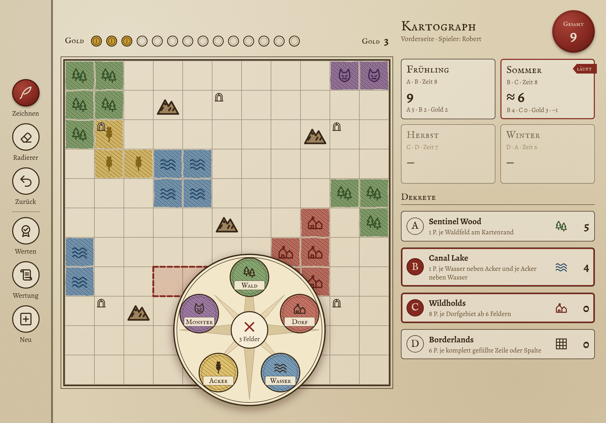
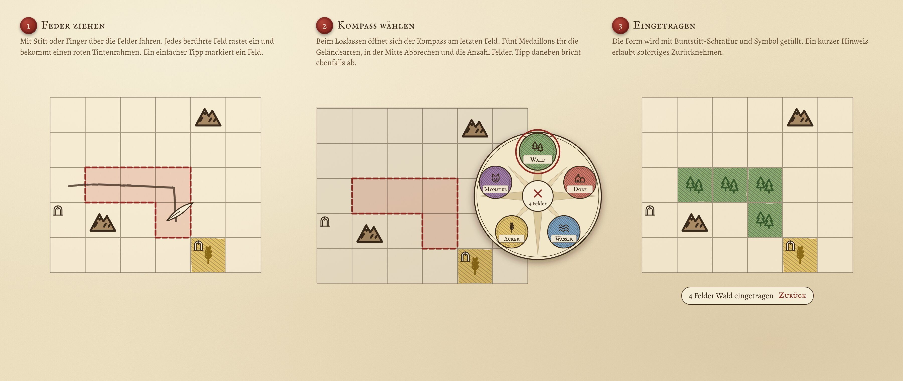
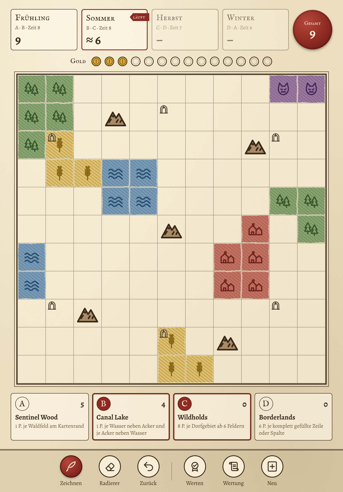
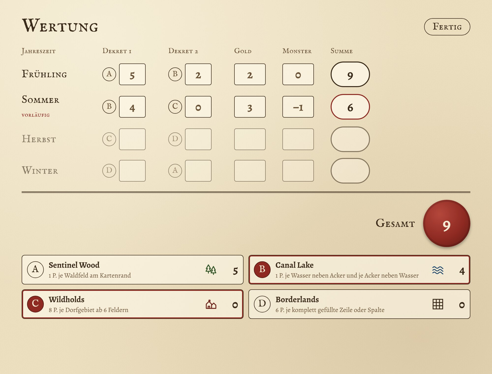
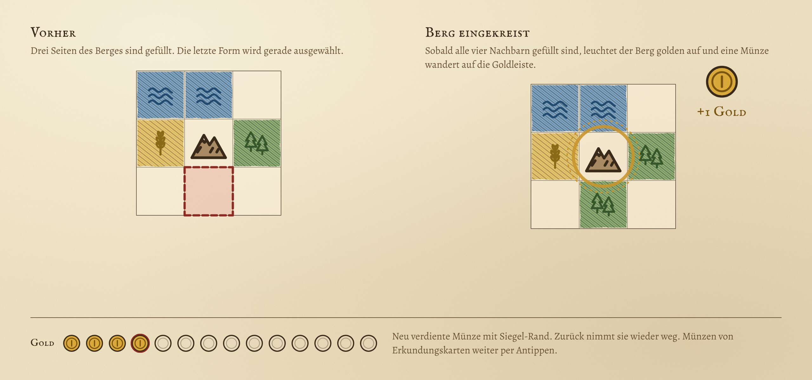

# Kartograph-Block

Web-App für das iPad als digitaler Ersatz für den Eintrageblock von
**„Der Kartograph“ / „Die Kartographin“** (Pegasus Spiele).
Erkundungskarten, Jahreszeiten und Monster werden weiter mit den echten Karten
am Tisch gespielt; die App ersetzt nur das Blatt Papier. Ein iPad entspricht einem
Spieler. Es gibt keinen Server.

**Zur App:** https://rab2385.github.io/artograph-block/

## Worum es geht

Jeder Spieler trägt seine Karte auf dem iPad ein, statt mit Buntstift auf Papier.
Die App rechnet die Wertung jeder Jahreszeit selbst aus (Dekrete, Gold, Monster)
und lässt sich jederzeit rückgängig machen. Bei Monster-Karten wird das iPad wie
ein Blatt Papier an den Nachbarn weitergereicht.

**Auf dem iPad installieren:** Seite in Safari öffnen → Teilen → „Zum Home-Bildschirm“.
Danach startet die App im Vollbild und funktioniert auch ohne Internet. Den Spielstand
speichert Safari nur dauerhaft, wenn die App auf dem Home-Bildschirm liegt.

## So sieht es aus

Entwürfe im Kartograph-Stil, Quelle in [`docs/mockups/`](docs/mockups/).

**Spielbildschirm (Querformat)** mit geöffnetem Kompass zur Geländewahl:



**Formen eintragen:** Felder ziehen, Gelände im Kompass wählen, fertig.



**Hochformat** und **Wertung:**

<p>
  
  
</p>

**Gold für eingekreiste Berge** wird automatisch erkannt:



## Loslegen

Voraussetzung: Node.js 22.

```bash
npm install
npm run dev       # lokaler Server mit automatischem Neuladen
npm test          # Unit-Tests (Vitest)
npm run build     # Typprüfung + Build nach dist/
npm run preview   # den fertigen Build lokal ansehen (inklusive Offline-Betrieb)
```

Die GitHub-Actions:

- `.github/workflows/ci.yml` testet und baut bei jedem Push und Pull Request.
- `.github/workflows/pages.yml` veröffentlicht bei jedem Push auf `main` auf GitHub Pages.

## Projektstruktur

```
index.html                      Einstieg (Meta-Tags für den Home-Bildschirm)
src/
  main.ts                       startet die App, registriert den Service Worker
  core/                         reine Spiellogik, ohne Oberfläche, vollständig getestet
    terrain.ts                  Geländearten, vorgedruckte Felder, Cell
    coordinate.ts               (row, column) + Nachbarn
    mapLayout.ts                Berg-/Ruinen-/Ödland-Positionen je Blockseite
    mapGrid.ts                  11×11 Raster, Bemalbarkeit, paint/erase, gefüllt/Gebiete
    season.ts                   Dekrete A–D, Jahreszeiten → Dekrete, Zeitlimits
    gameState.ts                kompletter Spielstand
    gameStore.ts                Speichern in localStorage
    undoHistory.ts              mehrstufiges Undo über Schnappschüsse
    gridGeometry.ts             Punkt ↔ Feld, Einrasten von Strichen
    scoring/
      cardIds.ts                alle 16 Karten (stabile IDs, Namen, Kategorien)
      scoringCard.ts            gemeinsame Form aller Wertungskarten
      catalog.ts                Zuordnung ID → Regel-Objekt
      engine.ts                 Jahreszeitenwertung, Monster-Minuspunkte
      cards/                    alle 16 Wertungskarten, je eine Datei, plus cards.test.ts
  ui/                           Oberfläche ohne Framework
    app.ts                      Bildschirmaufbau, Werkzeuge, Jahreszeiten, Dialoge
    board.ts                    Karte als SVG, Tippen und Freihand-Striche
    compass.ts                  Kompass zur Geländewahl und seine Platzierung
    controller.ts               Spielzustand, Undo, Autospeichern
    icons.ts                    Tintensymbole und Buntstift-Schraffur
    styles.css                  Gestaltung, Quer- und Hochformat
    fonts/                      IM Fell English SC und Alegreya (SIL OFL)
build/serviceWorker.ts          erzeugt beim Build sw.js für den Offline-Betrieb
public/                         Manifest, App-Symbole, Favicon
design/app-icon.svg             Quelle des App-Symbols
docs/mockups/                   Entwürfe (HTML-Quelle und Bilder)
```

## Datenmodell

| Typ | Inhalt |
|---|---|
| `Terrain` | `forest`, `village`, `water`, `farm`, `monster` |
| `PrintedFeature` | `free`, `mountain`, `ruins`, `wasteland` (vorgedruckt, unveränderlich) |
| `Cell` | `printed` + `terrain` (oder `null`) |
| `MapLayout` | Konfiguration einer Blockseite: Größe, Berge, Ruinen, Ödland |
| `MapGrid` | `size` × `size` Zellen; `isPaintable`, `isEmpty`, `paint`, `erase` |
| `Decree` / `Season` | A–D; Frühling A+B, Sommer B+C, Herbst C+D, Winter D+A |
| `DecreeAssignment` | welche Wertungskarte auf welchem Dekret liegt |
| `ScoringCard` | `id`, `category`, `ruleText`, `score(grid)` |
| `SeasonScore` | Punkte beider Dekrete, Gold, Monster-Minuspunkte |
| `GameState` | Raster, Dekrete, Gold, abgeschlossene Jahreszeiten |

**Begriffe der Wertung:** *Gefüllt* sind Felder mit eingetragenem Gelände sowie Berge und
Ödland; Ruinen gelten als leer, bis darauf gezeichnet wird. Ein *Gebiet* sind orthogonal
verbundene Felder derselben Geländeart (auch ein einzelnes Feld). Bei „umgeben“ zählt der
Kartenrand wie ein gefülltes Feld.

Alles im Kern sind **unveränderliche Daten** mit reinen Funktionen. Undo heißt
deshalb: den vorherigen `GameState` wiederherstellen. Speichern heißt: JSON schreiben.

## Bedienung

* **Antippen** eines Feldes markiert es, und neben der Auswahl erscheint der Kompass.
* **Ziehen** mit Stift oder Finger über mehrere Felder markiert alle überstrichenen
  Felder (eingerastet). Nach dem Loslassen erscheint der Kompass, und die gewählte
  Geländeart füllt die ganze Form.
* Ein Tipp neben den Kompass oder auf ✕ bricht ab.
* Der **Radierer** ist ein eigener Modus: Tippen oder Ziehen leert die Felder.
* **Zurück** macht die letzten Schritte rückgängig (auch Gold und Jahreszeitenwertung).
* **Gold** wird über das ganze Spiel gesammelt; jede Jahreszeit wertet das gesamte Gold.
  Münzen von Erkundungskarten trägt man mit +/− ein. Ein eingekreister Berg (alle vier
  Nachbarn gefüllt) bringt automatisch 1 Gold; er leuchtet golden, und seine Münze hat
  einen roten Rand. Radieren oder Zurück nimmt sie wieder weg.
* **Werten** schließt die laufende Jahreszeit ab. Die App rechnet aus dem Raster
  Dekret 1 + Dekret 2 + Gold + Monster-Minuspunkte.

## Offene Punkte

Siehe die [Issues](https://github.com/Rab2385/artograph-block/issues):

* **Wertungskarten:** alle 16 sind umgesetzt. Die Regeln stammen aus Regel-Nachschlagewerken
  im Netz und sollten einmal mit den echten Karten verglichen werden.
* **Deutsche Kartennamen und eigene Kurzregeln** (#5): in `cardIds.ts` und den Karten.
  Gespeicherte Spielstände bleiben gültig.
* **Positionen der Blockseiten** (#6, #7): Die Vorderseite stammt aus dem Gedächtnis,
  die Ödland-Rückseite ist ein Platzhalter. Beides steht in `mapLayout.ts`.
* **Ruinen** sind wie im Original bemalbar. Mit `ruinsArePaintable: false` im Layout
  lassen sie sich sperren.

Die frühere SwiftUI-Version steht in der Git-Historie (bis Commit `abd107b`).
